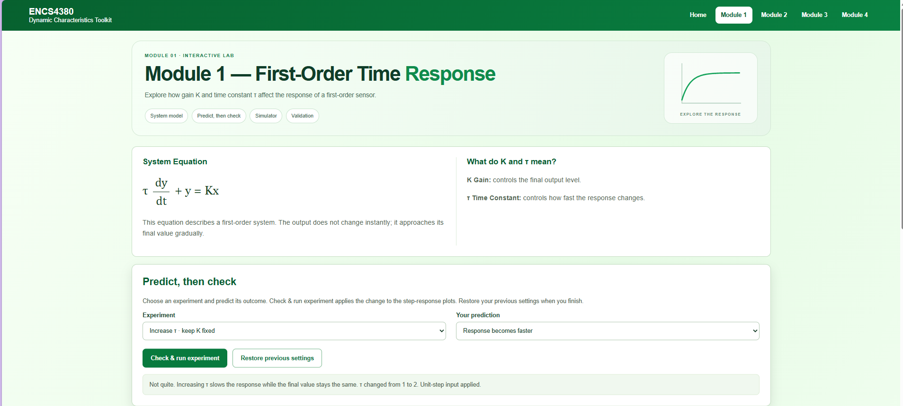
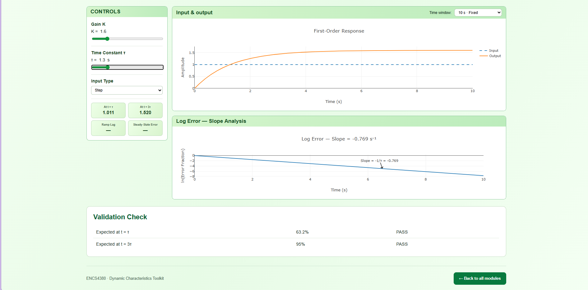
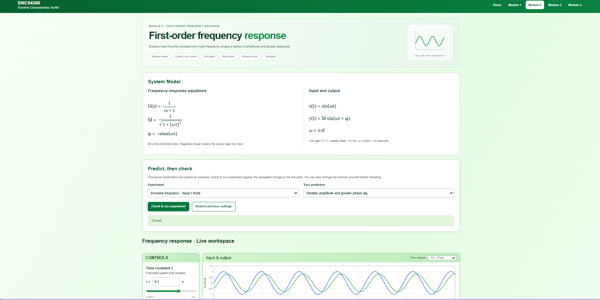
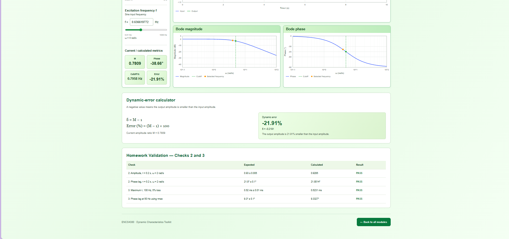
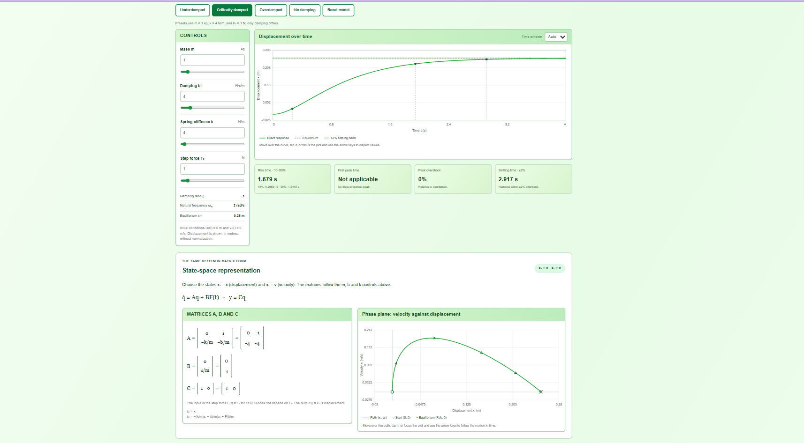
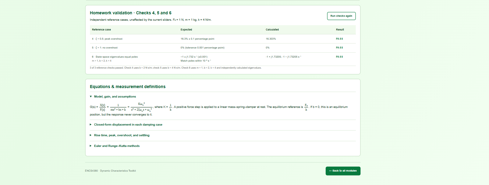

# 🌿 Rayhana · Interfacing Toolkit

**ENCS4380 · Interfacing Techniques · Birzeit University**

Interactive simulations for sensor dynamics and feedback control — everything runs live in the browser.

<table>
<tr>
<td align="center" width="50%">
<a href="#homework-1"><b>📘 Homework 1</b></a> 
Dynamic Characteristics 
Modules 1 – 4
</td>
<td align="center" width="50%">
<a href="#homework-2"><b>🎛️ Homework 2</b></a> 
PID Control Toolkit 
P1 – P4 · My System · Bonus
</td>
</tr>
</table>

---

# 📘 Homework 1 · Dynamic Characteristics

> How sensors respond to changing inputs — explored through live simulations, response plots, and prediction experiments.

## 📈 Module 01 · Time Response

Explore first-order step and ramp responses, time constant, and error fraction.

👤 Contributor · About this module · AI assistance

**Developed by:** Mayar Etawi

**About this module:**  
Module 1 explores the time response of a first-order sensor using interactive simulations. Users can adjust the gain \(K\) and time constant \(\tau\) and immediately observe how these parameters affect the system response.

The module supports both **step** and **ramp** inputs, with dynamically updated input and output plots. It also provides adjustable and automatic time windows so important response points remain visible during the simulation.

For step inputs, the module evaluates the response at \(t=\tau\) and \(t=3\tau\), and validates the expected first-order response values of approximately **63.2%** and **95%**.

A logarithmic error plot is also included to illustrate how the response error decreases with time and to show the relationship between the slope and the time constant, where the slope is \(-1/\tau\).

The **Predict, Then Check** experiment allows users to predict how increasing \(K\) or \(\tau\) will affect the response before running the experiment, making the module more interactive and focused on understanding the physical meaning of first-order system parameters.

**AI assistance:**  
Assisted with interface styling, equation formatting, updating prediction interactions, and fixing the time-window controls.

---

## 🌊 Module 02 · Frequency Response

Explore sine responses, amplitude ratio, phase lag, Bode plots, and dynamic error.

👤 Contributor · About this module · AI assistance

**Developed by:** Yasmin Badwan.

**About this module:**  
Module 2 explores the frequency response of a first-order sensor using interactive simulations. Users can adjust the time constant τ and input frequency and observe how these changes affect the output amplitude and phase lag.

The module compares input and output sine waves and displays Bode magnitude and phase plots, with markers for the selected frequency and cutoff frequency. Live measurements show the amplitude ratio, phase lag, and cutoff frequency, while the dynamic-error calculator expresses the relative amplitude error.

The Predict, Then Check experiment allows users to predict how changing the frequency or time constant affects the response, run the experiment, and restore previous settings. The module also includes homework validation checks 2 and 3.

**AI assistance:**  
Assisted with improving visual consistency, styling titles and navigation links, formatting mathematical expressions, and reviewing the displayed validation calculations.

---

## ⚙️ Module 03 · Second-Order Response

Explore damping, response measurements, poles, state-space representation, and Euler/RK4 comparison.

👤 Contributors · About this module · AI assistance

**Developed by:** Maryam Maslamani  
**State-space panel:** Yasmin Badwan

**About this module:**  
Simulate a mass–spring–damper system with adjustable mass, damping, stiffness, and input force. Compare underdamped, critically damped, overdamped, and undamped responses. Inspect response measurements and system poles, and compare Euler and fourth-order Runge–Kutta numerical solutions against the exact response.

Yasmin’s state-space panel displays live matrices A, B, and C, independently calculated eigenvalues, and phase-plane trajectories. The panel updates with the shared simulator controls and compares the eigenvalues with the system poles. It also includes homework validation check 6.

**AI assistance:**  
Assisted with introduction styling, formatting mathematical expressions as fractions, reviewing the displayed validation checks, testing module functionality, and integrating Maryam’s simulator with Yasmin’s state-space panel.

---

## 🎯 Module 04 · Guess the Sensor

Estimate hidden sensor parameters from noisy responses and score your guesses.

👤 Contributor · About this module · AI assistance

**Developed by:** Hala Shojaiah 

**About this module:**  
Module 4 provides an interactive challenge where users estimate the parameters of an unknown sensor by analyzing its response curve. Each round randomly generates either a first-order or second-order sensor with hidden parameters and adds a small amount of noise to simulate realistic measurements.

For first-order sensors, users estimate the time constant (τ) by analyzing the response curve, using methods such as the 63.2% response point. For second-order sensors, users estimate the damping ratio (ζ) and natural frequency (ωₙ) by observing response characteristics such as overshoot and peak time.

The module includes a **Hint** feature to guide users without immediately revealing the correct parameters. After submitting their estimates, users can reveal the actual sensor values and compare their predicted response with the true response on the same plot.

A scoring system evaluates the accuracy of the estimates, awarding full marks when the relative error is within 10%. The module also keeps a running score throughout the session and provides a **New Sensor** button to generate another challenge.

This module helps users apply the concepts learned in the previous modules by interpreting response curves and estimating sensor parameters instead of adjusting known values.

**AI assistance:**  
Assisted with interface styling, equation formatting, and debugging.

---

### 📸 Homework 1 screenshots

Open screenshots

#### Homepage

#### Module 1 – Time Response

#### Module 2 – Frequency Response

#### Module 3 – Second-Order Response

#### Module 4 – Guess the Sensor

<a href="#top">⬆ Back to top</a>

---

# 🎛️ Homework 2 · PID Control Toolkit

> Homework 1 showed how slow a system is. Homework 2 shows how to make it **faster and more accurate** using feedback.  
> Open it from the landing page → **Enter Homework 2** (`docs/control.html`).

| Module | Owner | What you can explore | Page |
|---|---|---|---|
| 🎚️ **P1 · PID Playground** | [P1 NAME] | Tune Kp, Ki, Kd on a 1st- or 2nd-order plant; live metrics and actuator limit | [`pid-playground.html`](docs/pid-playground.html) |
| 📡 **P2 · Slow Sensor** | [P2 NAME] | True output vs. what a slow sensor reports, and the move to oscillation | [`slow-sensor.html`](docs/slow-sensor.html) |
| 🔢 **P3 · Digital PID** | [P3 NAME] | Sampling time Ts, anti-windup, and generated Arduino code | [`digital-pid.html`](docs/digital-pid.html) |
| 🎯 **P4 · Tuning Challenge** | [P4 NAME] | Hidden random plant, spec with pass/fail per part, and a score | [`tuning-challenge.html`](docs/tuning-challenge.html) |
| 🐭 **My System** | Team | Micromouse drive-motor model, spec, PID design | [`project-model.html`](docs/project-model.html) |

Every module keeps the **Predict, then check** box, and every closed loop is simulated step by step with **RK4** — no closed-form shortcuts.

---

## 🎚️ P1 · PID Playground

Change the plant and the gains, then watch rise time, overshoot, settling time and steady-state error update live.

👤 Contributor · About this module · AI assistance

**Developed by:** [P1 NAME]

**About this module:**  
P1 shows the full feedback loop as a block diagram: setpoint, PID, actuator limit ±Umax, plant and unity negative feedback. The user picks the plant — first order \(K/(\tau s+1)\) from Module 1 or the mass–spring–damper from Module 3 — and sets Kp, Ki, Kd and the setpoint step.

Two plots are shown: the output against the setpoint, and the control signal u(t) with its limits. Live metrics report rise time (10–90%), overshoot, settling time (2% band) and final error. The derivative acts on the measurement to avoid derivative kick, and conditional integration prevents windup when the actuator saturates.

The **Predict, then check** box runs two RK4 simulations — before and after raising one gain — and checks the user's prediction against the measured change. P1 also contains the three **homework validation checks** (see below).

**AI assistance:**  
[What AI was used for in P1]

---

## 📡 P2 · A Slow Sensor in the Loop

Put a first-order sensor with time constant τs in the feedback path — the controller only controls what the sensor says.

👤 Contributor · About this module · AI assistance

**Developed by:** [P2 NAME]

**About this module:**  
The sensor is modelled as \(\dot y_s = (y - y_s)/\tau_s\), and the PID acts on the sensor reading instead of the true output. The true output and the measured value are drawn on the same plot, so the gap between them is visible.

As τs grows, the feedback information arrives later, the overshoot grows, and the loop moves towards oscillation. The **Predict, then check** box lets the user guess how a larger τs or a gain change will affect the response before running it.

**AI assistance:**  
[What AI was used for in P2]

---

## 🔢 P3 · Digital PID

Run the controller only at sample times, see the stair-step command, and copy the Arduino code for the current gains.

👤 Contributor · About this module · AI assistance

**Developed by:** [P3 NAME]

**About this module:**  
The controller follows the homework equation

$$u[k] = K_p e[k] + K_i T_s \sum_{j=0}^{k} e[j] + K_d \frac{e[k]-e[k-1]}{T_s}$$

The command is held between samples (zero-order hold), while the plant is integrated with RK4 at a much finer step. A comparison table runs Ts = 0.01, 0.10, 0.50 and 1.00 s with the same plant and gains, so the loss of performance as Ts grows is visible.

Anti-windup can be switched on or off; a second setpoint step shows how much faster the loop recovers with it. The page generates **Arduino loop code** with the current gains, Ts, limits and anti-windup setting, with **Copy** and **Download .ino** buttons.

**AI assistance:**  
[What AI was used for in P3]

---

## 🎯 P4 · Tuning Challenge

A hidden plant, a clear spec, and a score — tune the gains until every part passes.

👤 Contributor · About this module · AI assistance

**Developed by:** [P4 NAME]

**About this module:**  
Each round creates a hidden random plant, reusing Homework 1's Module 4 generator: either first order (K, τ) or second order (ζ, ωn). A new spec is drawn every round: an overshoot limit, a settling-time limit and zero steady-state error.

After **Run simulation**, the page shows **PASS / FAIL** for each part of the spec and a score out of 100, plus the best score of the session. A live preview, a prediction experiment and a CSV export of the last run are also included.

**AI assistance:**  
[What AI was used for in P4]

---

## 🐭 My System · Micromouse Drive Motor

Our project plant: an N20 geared motor with encoder, driven by a DRV8833 from an ESP32.

📐 Model · Spec · Design

**Plant model:** \(G(s) = K/(\tau s + 1)\) — input PWM duty (%), output wheel speed (RPM).

**Where the numbers come from:**  
- *Measured mode:* K = ΔRPM / ΔPWM and τ = time to 63.2% of the speed change, from a PWM step test logged with the encoder.  
- *Simulation mode:* illustrative values (K = 5 RPM/%, τ = 0.15 s) used until the measured values are entered. Motor source: [RoboticX — N20 Motor, 6 V, 530 RPM](https://roboticx.ps/product/n20-dc-motor-with-magnetic-encoder-6v-530-rpm/).

**Spec and why:**

| Requirement | Target |
|---|---|
| Damping ratio | 0.6 ≤ ζ ≤ 0.8 |
| Overshoot | ≤ 10% |
| Settling time (2%) | ≤ 1.0 s |
| Steady-state error | ≤ 2% |
| PWM command | 0 – 100% |

The mouse must hold a steady speed during short maze moves; too much overshoot or slow settling makes its movement inaccurate.

**Design:** final gains, the simulated speed and PWM response, the performance checks, and the Arduino code are on the [My System page](docs/project-model.html).

---

## 🎁 Bonus · Ziegler–Nichols and State-Space Control

🔍 What we built and who did what

**Ziegler–Nichols** — on the teaching plant \(G(s) = 1/(s+1)^3\) (a first-order motor never oscillates under P-only control):  
P-only experiment → sustained oscillation at **Ku = 8**, **Pu = 2π/√3 ≈ 3.63 s** → classic rules Kp = 0.6Ku, Ki = 1.2Ku/Pu, Kd = 0.075KuPu → before/after response with metrics.

**State-space** — on the Module 3 mass–spring–damper:  
state feedback \(u = -Kx + Nr\) with \(k_1 = m\omega_n^2 - k\), \(k_2 = 2m\zeta\omega_n - b\), \(N = m\omega_n^2\) → the page checks that eig(A − BK) equals the chosen poles, and compares the response with PID.

| Partner | Ziegler–Nichols | State-space |
|---|---|---|
| **P1** | P-only experiment to find sustained oscillation | State feedback u = −Kx on the 2nd-order plant |
| **P2** | Determine Ku and Pu and explain how | Explain state variables and matrices; choose target poles |
| **P3** | Calculate gains with the rules, simulate and verify | Compare state feedback with PID (same plant and initial state) |
| **P4** | Display gains and before/after response with metrics | Calculate K for the chosen poles; show poles, gains and response |

---

## ✅ Validation Checks

For the plant \(K/(\tau s + 1)\) with K = 1 and τ = 1 s — run them from P1 with **Run validation**:

| # | Check | Expected |
|---|---|---|
| 1 | P only, Kp = 9 | τclosed = 0.1 s, steady-state error = 10% |
| 2 | PI, Kp = 1, Ki = 1 | ωn = 1 rad/s, ζ = 1 |
| 3 | Any stable PI | Zero steady-state error for a step |

---

### 📸 Homework 2 screenshots

Open screenshots

#### Control home

#### P1 · PID Playground

#### P2 · Slow Sensor

#### P3 · Digital PID

#### P4 · Tuning Challenge

#### My System

<a href="#top">⬆ Back to top</a>

---

## 🚀 Run locally

1. Download or clone the repository.
2. Open `docs/index.html` in a browser.
3. Choose **Homework 1** or **Homework 2**, then a module.

An internet connection is required to load Plotly (Homework 1 Modules 1 and 4, and Homework 2 P1 and P2).

## 🛠️ Built with

HTML · CSS · JavaScript · Plotly.js · RK4 numerical integration · GitHub Pages
