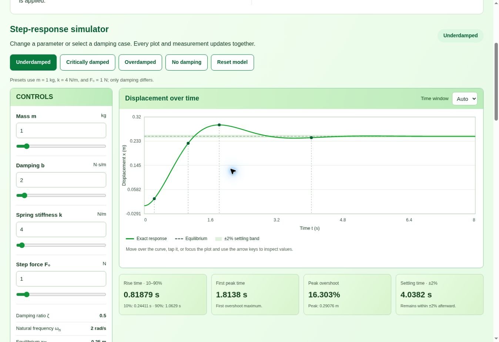

# ENCS4380 — Dynamic Characteristics Toolkit

An interactive educational toolkit for exploring sensor dynamics, built for ENCS4380 Interfacing Techniques at Birzeit University.

**Website:** [Open the toolkit](https://mayaretawi.github.io/encs4380-dynamics-Rayhana-/)

## Modules and responsibilities

| Module | Focus | Responsibility |
| --- | --- | --- |
| 1 | First-order step and ramp responses | Mayar |
| 2 | First-order frequency response | Yasmin |
| 3 | Second-order response, measurements, poles, Euler/RK4 comparison | Maryam |
| 3, state-space panel | Matrices, eigenvalues, phase plane, validation check 6 | Yasmin |
| 4 | Guess the sensor | Group's Module 4 owner |

Modules 1–3 are linked from the homepage. Module 4 remains under development. Yasmin's state-space panel has an integration location and shared data interface ready; its implementation remains with Yasmin.

## Module 3

- Shared mass, damping, stiffness, and force controls, with editable number fields and sliders.
- Exact underdamped, critically damped, and overdamped step responses; an undamped boundary case.
- Live damping ratio, natural frequency, and equilibrium displacement.
- 10–90% rise time, first peak time, percentage overshoot, and exact ±2% settling time.
- Poles plotted in the complex plane, including repeated poles.
- Three prediction experiments with feedback and restoration of previous settings.
- Explicit Euler and fourth-order Runge–Kutta solvers, overlaid on the exact response, with error measurements and stability feedback.
- Visible homework validation checks 4 and 5.
- Responsive layout, keyboard controls, touch inspection, and expandable equation explanations.
- No new libraries, build tools, backend, or account required to use this module.

### Preview



### Integration and maintenance

- [Yasmin's integration instructions](docs/integration-yasmin.md)
- [Module 3 model and implementation guide](docs/module3-guide.md)
- Mathematical functions: `docs/module3-model.js`.
- Interface and shared subscription API: `docs/module3.js`.
- Page: `docs/module3.html`; additional styling: `docs/module3.css`.

The model is force-to-displacement: `m*x'' + b*x' + k*x = F(t)`. All trajectories use physical units, zero initial conditions, and equilibrium displacement `F₀/k`.

## Run locally

Open the repository folder in VS Code. Open `docs/index.html` with a local web preview extension, or serve the folder using Python:

```sh
python -m http.server 8000 --directory docs
```

Then open `http://localhost:8000`. Module 3 can also be opened directly as `docs/module3.html`.

## Verify the mathematical model

With Node.js installed, from the repository root:

```sh
node --test tests/module3-model.test.cjs
```

Tests cover independent reference responses, continuity around critical damping, measured crossings, pole consistency, force scaling, solver convergence, numerical stability, and invalid inputs.

## GitHub Pages

Publish from the `main` branch and `/docs` folder in repository Settings → Pages. Branch changes appear on the public website after merging into `main` and a successful Pages deployment.

Keep each member's work in their own commits. The final group release, Module 4, remaining state-space work, final screenshots, and submission are coordinated by the relevant group owners.
