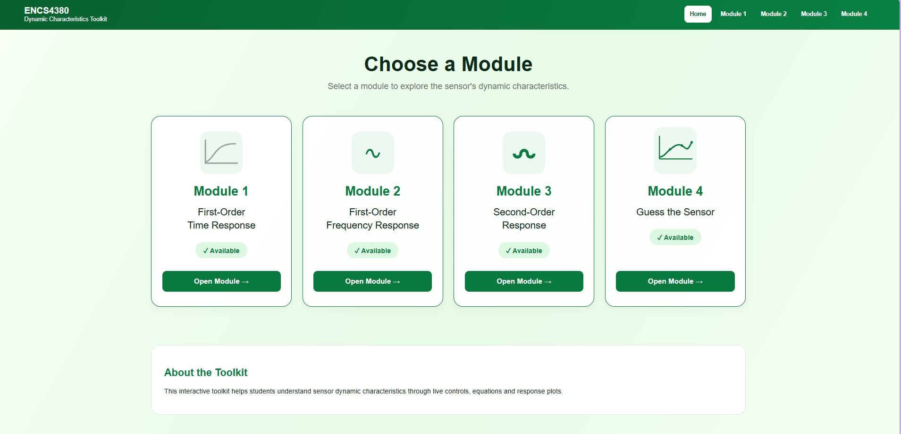
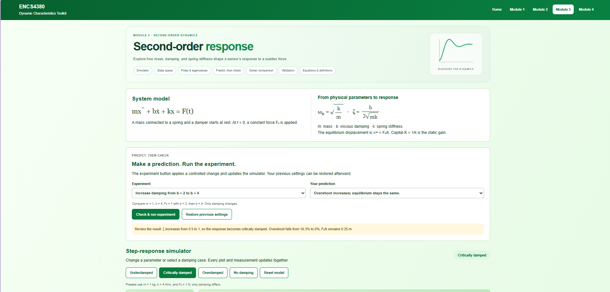
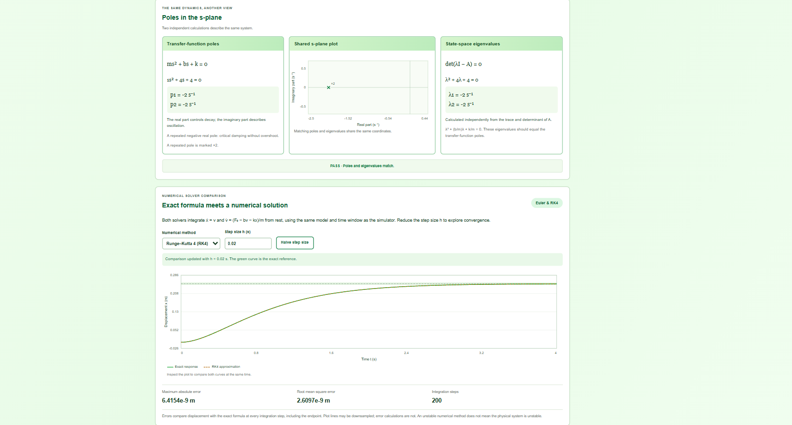
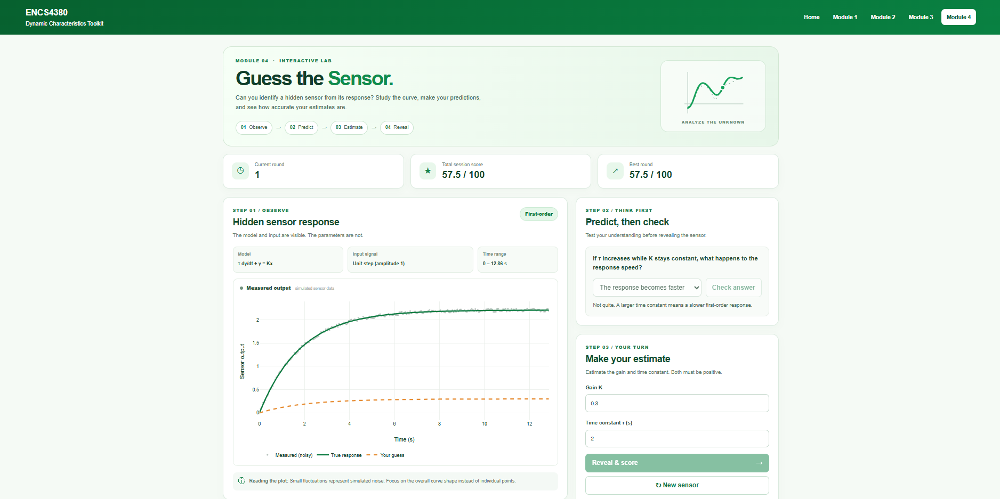
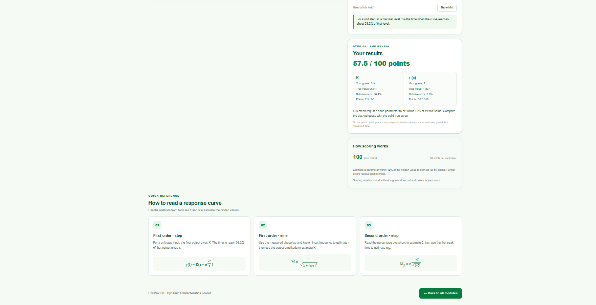

# 🌿 Rayhana · Interfacing Toolkit

**ENCS4380 · Interfacing Techniques · Birzeit University**

Interactive simulations for sensor dynamics and feedback control — everything runs live in the browser.

<table>
<tr>

<td align="center" width="33%">
<a href="https://mayaretawi.github.io/encs4380-dynamics-Rayhana/">
<b>Live Website</b>
</a> 

</td>

<td align="center" width="33%">
<a href="#homework-1">
<b> Homework1</b>
</a> 

</td>

<td align="center" width="33%">
<a href="#homework-2">
<b> Homework2</b>
</a> 
</td>

</tr>
</table>

---

# 📘 Homework 1 · Dynamic Characteristics

> How sensors respond to changing inputs — explored through live simulations, response plots, and prediction experiments.

## 📈 Module 01 · Time Response

Explore first-order step and ramp responses, time constant, and error fraction.

👤 Contributor · About this module · AI assistance

**Developed by:** Mayar Etawi

**About this module:**  
Module 1 explores the time response of a first-order sensor using interactive simulations. Users can adjust the gain \(K\) and time constant \(\tau\) and immediately observe how these parameters affect the system response.

The module supports both **step** and **ramp** inputs, with dynamically updated input and output plots. It also provides adjustable and automatic time windows so important response points remain visible during the simulation.

For step inputs, the module evaluates the response at \(t=\tau\) and \(t=3\tau\), and validates the expected first-order response values of approximately **63.2%** and **95%**.

A logarithmic error plot is also included to illustrate how the response error decreases with time and to show the relationship between the slope and the time constant, where the slope is \(-1/\tau\).

The **Predict, Then Check** experiment allows users to predict how increasing \(K\) or \(\tau\) will affect the response before running the experiment, making the module more interactive and focused on understanding the physical meaning of first-order system parameters.

**AI assistance:**  
Assisted with interface styling, equation formatting, updating prediction interactions, and fixing the time-window controls.

---

## 🌊 Module 02 · Frequency Response

Explore sine responses, amplitude ratio, phase lag, Bode plots, and dynamic error.

👤 Contributor · About this module · AI assistance

**Developed by:** Yasmin Badwan

**About this module:**  
Module 2 explores the frequency response of a first-order sensor using interactive simulations. Users can adjust the time constant \(\tau\) and input frequency and observe how these changes affect the output amplitude and phase lag.

The module compares input and output sine waves and displays Bode magnitude and phase plots, with markers for the selected frequency and cutoff frequency. Live measurements show the amplitude ratio, phase lag, and cutoff frequency, while the dynamic-error calculator expresses the relative amplitude error.

The **Predict, Then Check** experiment allows users to predict how changing the frequency or time constant affects the response, run the experiment, and restore previous settings. The module also includes homework validation checks 2 and 3.

**AI assistance:**  
Assisted with improving visual consistency, styling titles and navigation links, formatting mathematical expressions, and reviewing the displayed validation calculations.

---

## ⚙️ Module 03 · Second-Order Response

Explore damping, response measurements, poles, state-space representation, and Euler/RK4 comparison.

👤 Contributors · About this module · AI assistance

**Developed by:** Maryam Maslamani  
**State-space panel:** Yasmin Badwan

**About this module:**  
Simulate a mass–spring–damper system with adjustable mass, damping, stiffness, and input force. Compare underdamped, critically damped, overdamped, and undamped responses. Inspect response measurements and system poles, and compare Euler and fourth-order Runge–Kutta numerical solutions against the exact response.

Yasmin’s state-space panel displays live matrices A, B, and C, independently calculated eigenvalues, and phase-plane trajectories. The panel updates with the shared simulator controls and compares the eigenvalues with the system poles. It also includes homework validation check 6.

**AI assistance:**  
Assisted with introduction styling, formatting mathematical expressions as fractions, reviewing the displayed validation checks, testing module functionality, and integrating Maryam’s simulator with Yasmin’s state-space panel.

---

## 🎯 Module 04 · Guess the Sensor

Estimate hidden sensor parameters from noisy responses and score your guesses.

👤 Contributor · About this module · AI assistance

**Developed by:** Hala Shojaiah

**About this module:**  
Module 4 provides an interactive challenge where users estimate the parameters of an unknown sensor by analyzing its response curve. Each round randomly generates either a first-order or second-order sensor with hidden parameters and adds a small amount of noise to simulate realistic measurements.

For first-order sensors, users estimate the time constant \(\tau\) by analyzing the response curve, using methods such as the 63.2% response point. For second-order sensors, users estimate the damping ratio \(\zeta\) and natural frequency \(\omega_n\) by observing response characteristics such as overshoot and peak time.

The module includes a **Hint** feature to guide users without immediately revealing the correct parameters. After submitting their estimates, users can reveal the actual sensor values and compare their predicted response with the true response on the same plot.

A scoring system evaluates the accuracy of the estimates, awarding full marks when the relative error is within 10%. The module also keeps a running score throughout the session and provides a **New Sensor** button to generate another challenge.

This module helps users apply the concepts learned in the previous modules by interpreting response curves and estimating sensor parameters instead of adjusting known values.

**AI assistance:**  
Assisted with interface styling, equation formatting, and debugging.

---

### 📸 Homework 1 Screenshots

Open screenshots

#### Homepage

#### Module 1 – Time Response

#### Module 2 – Frequency Response

#### Module 3 – Second-Order Response

#### Module 4 – Guess the Sensor

<a href="#top">⬆ Back to top</a>

---

# 🎛️ Homework 2 · PID Control Toolkit

> Homework 1 showed how slow a system is. Homework 2 shows how to make it **faster and more accurate** using feedback.

Open it from the landing page → **Enter Homework 2** (`docs/control.html`).

## 🎚️ Module P1 · PID Playground

Tune a PID controller on first- or second-order plants and observe how each gain affects the closed-loop response.

👤 Contributor · About this module · AI assistance

**Developed by:** [P1 NAME]

**About this module:**  
P1 shows the full feedback loop as a block diagram: setpoint, PID, actuator limit ±Umax, plant, and unity negative feedback.

The user picks the plant — first order \(K/(\tau s+1)\) from Module 1 or the mass–spring–damper model from Module 3 — and sets \(K_p\), \(K_i\), \(K_d\), and the setpoint step.

Two plots are shown: the output against the setpoint, and the control signal \(u(t)\) with its limits. Live metrics report **rise time (10–90%)**, **overshoot**, **settling time (2% band)**, and **steady-state error**.

The derivative acts on the measurement to avoid derivative kick, and conditional integration prevents windup when the actuator saturates.

The **Predict, Then Check** experiment runs two RK4 simulations — before and after raising one gain — and checks the user's prediction against the measured change.

P1 also contains the three **Homework validation checks**.

**AI assistance:**  
[What AI was used for in P1]

---

## 📡 Module P2 · A Slow Sensor in the Loop

Study how sensor dynamics inside the feedback path affect the true output, measured output, overshoot, and oscillation.

👤 Contributor · About this module · AI assistance

**Developed by:** [P2 NAME]

**About this module:**  
P2 places a first-order sensor with time constant \(\tau_s\) in the feedback path. The controller acts on the sensor reading rather than directly on the true output.

The sensor is modelled as

\[
\dot y_s = \frac{y-y_s}{\tau_s}
\]

The true output and measured value are drawn on the same plot, making the difference between the actual system response and the sensor reading visible.

As \(\tau_s\) grows, the feedback information becomes slower. The resulting delay can increase overshoot and move the closed loop toward oscillation.

The **Predict, Then Check** experiment lets the user predict how increasing \(\tau_s\) or changing the controller gains will affect the response before running the simulation.

**AI assistance:**  
[What AI was used for in P2]

---

## 🔢 Module P3 · Digital PID

Explore sampling time, discrete PID control, anti-windup, stair-step control signals, and automatically generated Arduino code.

👤 Contributor · About this module · AI assistance

**Developed by:** [P3 NAME]

**About this module:**  
P3 implements the digital PID controller using the homework equation:

\[
u[k] =
K_p e[k]
+
K_i T_s \sum_{j=0}^{k} e[j]
+
K_d\frac{e[k]-e[k-1]}{T_s}
\]

The controller runs only at the selected sampling instants. Between samples, the command is held using **zero-order hold**, while the plant is integrated with RK4 at a much finer simulation step.

A comparison table runs:

- \(T_s = 0.01\) s
- \(T_s = 0.10\) s
- \(T_s = 0.50\) s
- \(T_s = 1.00\) s

using the same plant and controller gains, making the effect of increasing sampling time visible.

Anti-windup can be switched on or off. A second setpoint step demonstrates how anti-windup affects recovery after actuator saturation.

The page also generates **Arduino loop code** using the current gains, sampling time, actuator limits, and anti-windup setting. The generated code can be copied directly using the **Copy** button or saved using **Download .ino**.

**AI assistance:**  
[What AI was used for in P3]

---
## 🎯 Module P4 · Tuning Challenge

Tune a hidden plant to satisfy a randomly generated performance specification.

👤 Contributor · About this module · AI assistance

**Developed by:** Yasmin Badwan

**About this module:**  
P4 creates a hidden random plant, reusing the Homework 1 Module 4 generator. The plant can be either:

- First order with $K$ and $\tau$
- Second order with $\zeta$ and $\omega_n$

A new specification is generated for each round. The specification includes an overshoot limit, a settling-time limit, and a zero steady-state-error requirement.

After **Run Simulation**, the page reports **PASS / FAIL** for each part of the specification and calculates an overall score out of 100.

The challenge also includes a live preview, a **Predict, Then Check** experiment, and CSV export of the latest simulation results.

The user can continue tuning the controller and start a new challenge to test the design again.

**AI assistance:**  
Assisted with interface styling, equation formatting, updating prediction interactions, and debugging the scoring and pass/fail checks.

---

## 🐭 Module · My System · Micromouse Drive Motor

Apply the PID toolkit to the actual actuator used in the Micromouse project.

📐 Model · Spec · Design

**Project plant:**  
An N20 geared motor with encoder, driven by a DRV8833 from an ESP32.

**Plant model:**

\[
G(s)=\frac{K}{\tau s+1}
\]

The input is PWM duty (%) and the output is wheel speed (RPM).

**Where the numbers come from:**

- **Measured mode:**  
  \(K=\Delta RPM/\Delta PWM\)

  and

  \(\tau\) is obtained from the time required to reach 63.2% of the speed change during a PWM step test logged with the encoder.

- **Simulation mode:**  
  Illustrative values \(K=5\) RPM/% and \(\tau=0.15\) s are used until measured values are entered.

**Motor source:**  
[RoboticX — N20 Motor, 6 V, 530 RPM](https://roboticx.ps/product/n20-dc-motor-with-magnetic-encoder-6v-530-rpm/)

### Specification

| Requirement | Target |
|---|---:|
| Damping ratio | \(0.6 \leq \zeta \leq 0.8\) |
| Overshoot | \(\leq 10\%\) |
| Settling time (2%) | \(\leq 1.0\) s |
| Steady-state error | \(\leq 2\%\) |
| PWM command | 0–100% |

The mouse must hold a steady speed during short maze moves; excessive overshoot or slow settling can reduce movement accuracy.

### Design

The **My System** page contains the plant model, controller design, simulated speed and PWM response, performance checks, and generated Arduino code.

---

## 🎁 Bonus · Ziegler–Nichols and State-Space Control

Explore two advanced control approaches beyond the main PID modules.

🔍 What we built and who did what

### Ziegler–Nichols

The Ziegler–Nichols experiment uses the teaching plant

\[
G(s)=\frac{1}{(s+1)^3}
\]

A first-order motor does not produce sustained oscillation under P-only control, so this teaching plant is used for the experiment.

The workflow is:

1. Run a P-only experiment.
2. Increase the proportional gain until sustained oscillation occurs.
3. Determine the critical gain \(K_u\).
4. Determine the oscillation period \(P_u\).
5. Apply the classic Ziegler–Nichols rules.
6. Compare the response before and after tuning.

The implemented experiment uses:

\[
K_u=8
\]

\[
P_u=\frac{2\pi}{\sqrt{3}}\approx3.63\text{ s}
\]

The resulting gains are calculated using:

\[
K_p=0.6K_u
\]

\[
K_i=\frac{1.2K_u}{P_u}
\]

\[
K_d=0.075K_uP_u
\]

The page displays the calculated gains and compares the before/after response using performance metrics.

### State-Space Control

The state-space bonus is applied to the Module 3 mass–spring–damper model.

The controller uses state feedback:

\[
u=-Kx+Nr
\]

The feedback gains are calculated from the desired natural frequency and damping ratio:

\[
k_1=m\omega_n^2-k
\]

\[
k_2=2m\zeta\omega_n-b
\]

with the reference prefilter:

\[
N=m\omega_n^2
\]

The page checks that the eigenvalues of

\[
A-BK
\]

match the selected desired closed-loop poles and compares the state-feedback response with the PID response.

### Team Contribution

| Partner | Ziegler–Nichols | State-space |
|---|---|---|
| **P1** | P-only experiment to find sustained oscillation | State feedback \(u=-Kx\) on the 2nd-order plant |
| **P2** | Determine \(K_u\) and \(P_u\) and explain how | Explain state variables and matrices; choose target poles |
| **P3** | Calculate gains using the rules, simulate, and verify | Compare state feedback with PID on the same plant and initial state |
| **P4** | Display gains and before/after response with metrics | Calculate \(K\) for the chosen poles; show poles, gains, and response |

---

### 📸 Homework 2 Screenshots

Open screenshots

#### Control Home

#### P1 · PID Playground

#### P2 · Slow Sensor

#### P3 · Digital PID

#### P4 · Tuning Challenge

#### My System

<a href="#top">⬆ Back to top</a>

---

## 🚀 Run Locally

1. Download or clone the repository.
2. Open `docs/index.html` in a browser.
3. Choose **Homework 1** or **Homework 2**, then select a module.

An internet connection is required to load Plotly for Homework 1 Modules 1 and 4, and Homework 2 P1 and P2.

---

## 🛠️ Built With

HTML · CSS · JavaScript · Plotly.js · RK4 numerical integration · GitHub Pages
